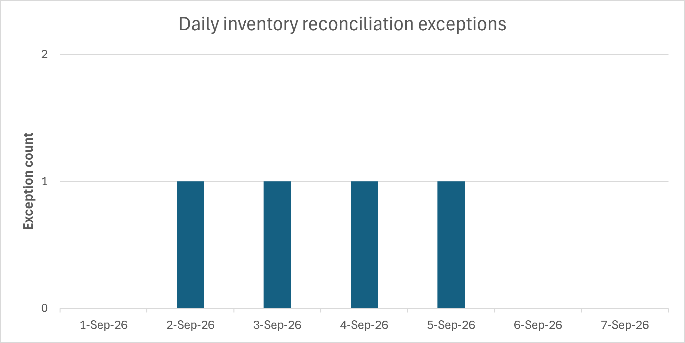

# Ghost Inventory

Ghost Inventory is a PostgreSQL project that reconciles simulated inventory
snapshots from an enterprise resource planning (ERP) system and a warehouse
management system (WMS). It identifies differences in recorded physical and
available quantities, then prioritises exceptions for investigation.

The demonstration covers **1–7 September 2026** and includes **30 SKUs across
two warehouses**.

## Results

From 1 to 7 September 2026, **416 of 420 simulated inventory observations
matched between ERP and WMS (99.05%)**. The reconciliation flagged four
exceptions for investigation, one P1 and three P2. The P1 exception was
BAT009 at WH01, where the ERP snapshot had no corresponding WMS record.

The [inventory operations report](docs/operations-report.md) contains the
seven-day summary, the investigation queue, metric definitions and a
worked example explaining the difference in available quantity for BAT001.

## Reconciliation rules

Records are matched by snapshot date, SKU and warehouse. The reconciliation
includes combinations present in either system, so a record missing from
one system can be flagged for investigation.

| System | Available quantity in this project |
| --- | --- |
| ERP | On-hand quantity minus allocated quantity |
| WMS | Physical quantity minus reserved, damaged and quarantined quantities |

The history view tracks consecutive days with an observed exception.
A matching record or a gap between observation dates breaks the streak.

| Priority | Rule, evaluated in this order |
| --- | --- |
| P1 | A record is missing from one system, or an exception has persisted for at least two consecutive calendar days. |
| P2 | ERP available quantity exceeds WMS available quantity. |
| P3 | Any remaining reconciliation exception. |

## Running the project

Use PostgreSQL for the reconciliation and reporting queries. The repository
contains simulated inputs in `data/raw/` and labelled exceptions in
`data/reference/`.

| Order | File | Purpose |
| --- | --- | --- |
| 1 | [`01_create_tables.sql`](sql/01_create_tables.sql) | Create the raw ERP and WMS inventory tables. |
| 2 | [`load_data.py`](src/load_data.py) | Load the ERP and WMS CSV inputs into PostgreSQL. |
| 3 | [`02_reconcile_inventory.sql`](sql/02_reconcile_inventory.sql) | Run the basic reconciliation query and inspect the quantity differences. |
| 4 | [`03_classified_possible_problem.sql`](sql/03_classified_possible_problem.sql) | Create the `inventory_reconciliation` view with discrepancy classifications, possible causes and separate mismatch flags for physical and available quantities. |
| 5 | [`04_analyse_inventory_history.sql`](sql/04_analyse_inventory_history.sql) | Create the `inventory_history` view and calculate the mismatch streak as at each observation date. |
| 6 | [`05_inventory_operations_report.sql`](sql/05_inventory_operations_report.sql) | Create the `inventory_operations_report` view for the demonstration period. Run the final `SELECT` for investigation priorities and reasons. |
| 7 | [`daily_summary.sql`](sql/daily_summary.sql) | Query `inventory_operations_report` to produce one row per day with observed, matched and exception counts and the daily match rate. |

To check the detected exceptions against the labelled scenarios, use
[`validate_detection.py`](src/validate_detection.py) and
`data/reference/ground_truth_reason.csv`.

## Data and report files

| Location | Contents |
| --- | --- |
| `data/raw/` | Simulated ERP and WMS snapshot CSVs used as inputs. |
| `data/reference/` | Ground-truth labels used to validate detected exceptions. |
| `sql/` | Queries and view definitions used to reproduce the results. |
| `src/` | Python scripts for generating, loading and validating data. |
| `docs/` | Operations report with results and the BAT001 case study. |

